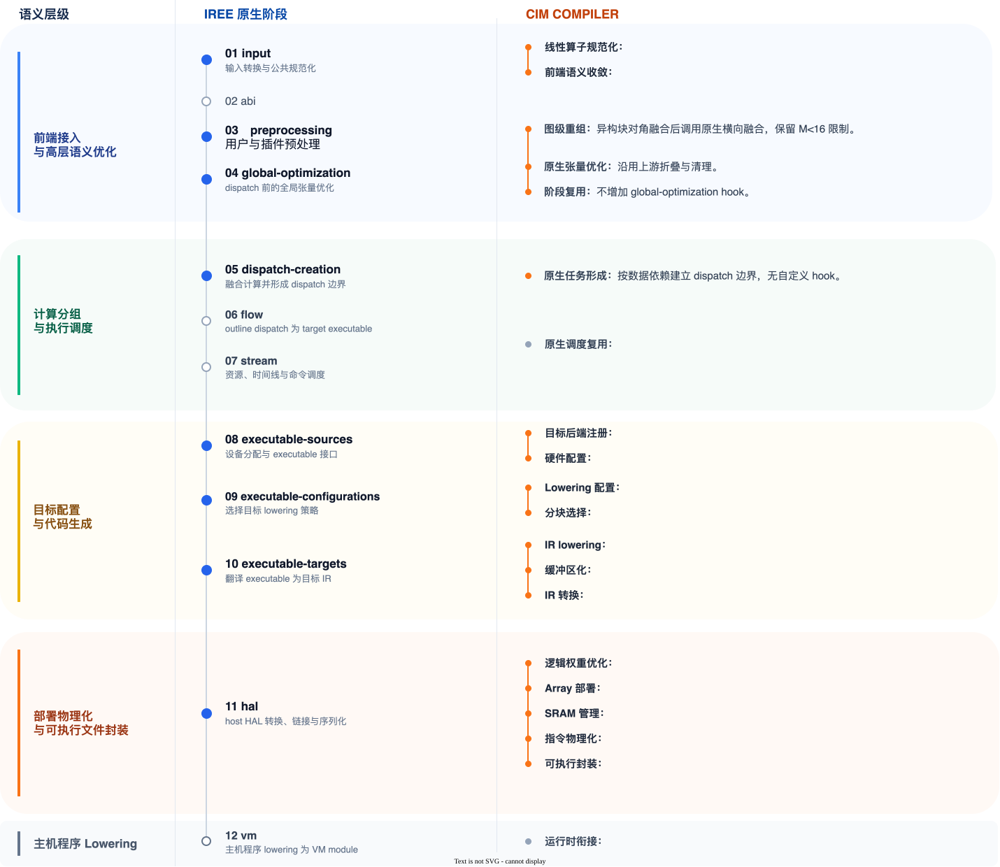
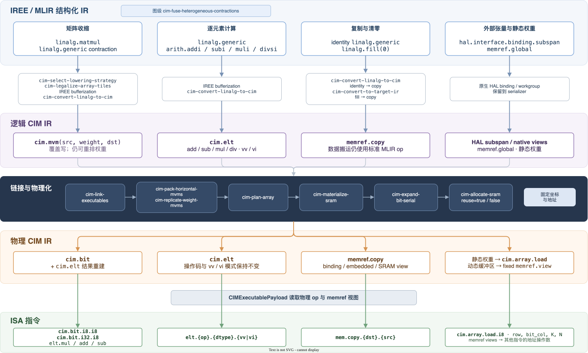

# 单阵列 CIM 编译器设计

目标设备由一个 `1024 × 4096 bit` 存算阵列和 512 KiB SRAM 构成。i8 权重将阵列划分为 `1024 × 512` 个可编程单元；权重在部署时写入，推理期间由激活值逐位驱动。SRAM 保存输入、输出、矩阵乘部分和及位串行暂存。

编译器接收 ONNX 整数模型，经 IREE 形成可调度的计算任务，再将其中的线性计算逐步变成带阵列坐标和 SRAM 地址的物理程序。完整学习路径见 [CIM 编译流程](guide/README.md)，精确阶段表见 [IREE 接入阶段](pipeline.md)。

## 程序如何获得物理含义

以下计算贯穿整个下降过程：

\[
Y=XW+b,\qquad X\in\mathbb Z^{M\times K},\quad
W\in\mathbb Z^{K\times N},\quad Y\in\mathbb Z^{M\times N}.
\]

ONNX 中的 \(W\) 只是常量张量。进入 CIM 后端后，它先成为逻辑矩阵乘的权重，随后被切成阵列可容纳的矩形，并与其他权重一起确定物理坐标。逻辑矩阵乘再按激活值位宽展开，产生阵列计算和 SRAM 上的整数重建指令。

图 1 的重点是两个被延后的物理决策。阵列坐标要等链接汇集全部静态权重后才能确定，SRAM 地址则要等位串行展开产生全部暂存后才能分配；此前的张量图和 dispatch 分别保留这两项决策所需的计算关系与任务边界。

## 两级 CIM 表达

逻辑 `cim.mvm` 表示一个 `[K,N]` 权重矩形上的整数矩阵向量乘。它引用 `memref` 视图而不携带阵列坐标，因此链接后的横向拼接和权重复制仍能改写同一计算。异构块对角融合发生在更早的张量图上，K/N 合法化发生在缓冲化之前的 `linalg` 上。

权重放置完成后，逻辑 MVM 展开为有序的物理过程：动态数据进入 SRAM，激活值逐位驱动阵列，部分结果在 SRAM 中恢复为整数。权重写入属于更早执行的部署入口，因此每轮计算都引用同一固定矩形。

图 2 上半部分保存可改写的矩阵关系，下半部分已经具有设备执行所需的操作顺序和存储视图。操作语义由 [CIM IR 规范](spec/cim-dialect-surface-spec.md) 定义。

## 权重与动态数据的规划

独立异构矩阵乘在全局优化时先合成块对角计算。单个权重矩形仍受阵列行列容量约束：K 方向切分产生部分和，N 方向切分产生相邻输出列。尺寸合法后，链接阶段再按共享激活值和连续激活行合并窗口。

链接阶段汇集整个部署的静态权重。规划器先合并内容相同的矩形，再为剩余矩形选择固定坐标。布局确定后，唯一部署入口按这些坐标写入阵列，计算入口沿用相同视图读取权重。

位串行展开补全运行时所需的临时对象。SRAM 分配器根据对象及其别名的活跃区间复用地址，把所有动态视图收敛到一段固定大小的根区域。最终地址峰值受 512 KiB 容量约束。

## 可执行程序

序列化器从同一份物理程序生成 `CimExecutable` payload 和 `.cim.isa` 文本。payload 随 `hal.executable.binary` 进入 VMFB，由 Runtime 执行；ISA 文本保留相同的操作顺序、阵列范围和 SRAM 地址，用于阅读与检查。

模块实例建立时先执行部署入口，使权重常驻阵列。此后的 compute dispatch 为当前 workgroup 建立 SRAM，并按 [运行规范](spec/README.md) 完成输入搬运、逐位计算和结果写回。

## 代码组织

- `Frontend`：ONNX 线性层规范化。
- `IR`：CIM 操作、类型与内存效应。
- `Codegen`：tiling、逻辑计算转换、权重重组及 Array/SRAM 物理化。
- `Target`：IREE target hooks、payload 与 ISA 序列化。
- `Common`：硬件参数和 compiler/runtime 共享格式。
- `runtime`：加载 payload，执行部署与工作组程序。

`CIMMVMUtils` 共用 contraction、别名/效应、权重读取和地址归约；SRAM 分配与循环展开调用 MLIR/IREE 原生 pass。
