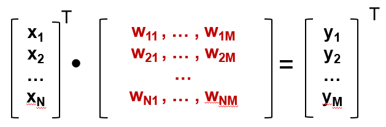
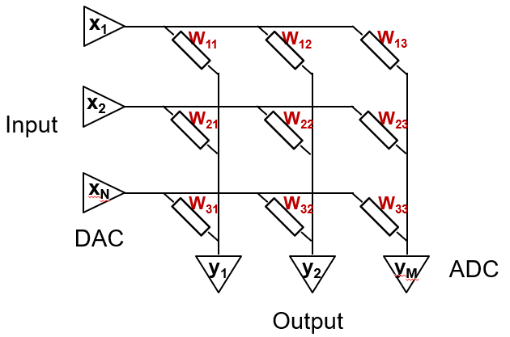
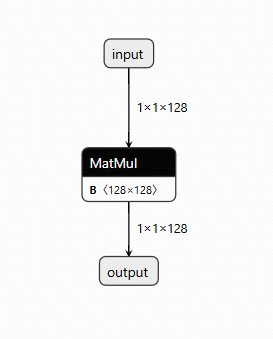
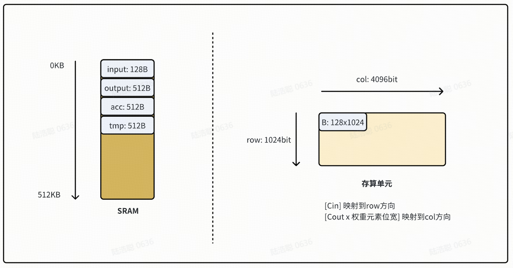
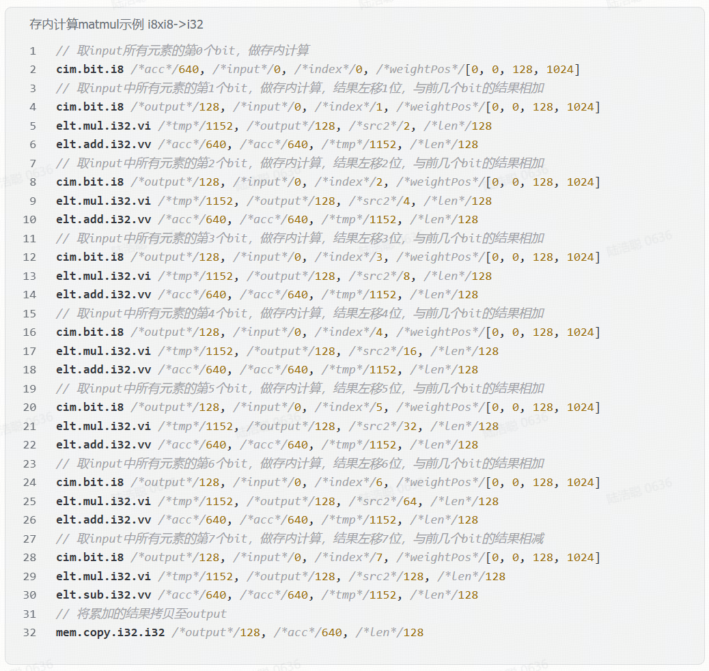

# 2026 知存科技杯赛题详情

> 来源：`doc/archive/contest/2026知存科技杯-存算一体编译器架构设计.docx`。
> 本文从 archive 提取为 active contest reference。赛题原文不在此处删改；本项目扩展说明用独立小节标出，用于后续 SPEC 和实现对齐。

## 1. 赛题背景及意义

随着大模型技术的快速演进与边缘计算的普及，传统冯·诺依曼架构正面临“内存墙”与“能耗墙”的双重挑战。在这一背景下，存算一体架构以其高能效比与高计算密度的优势，成为突破计算瓶颈的关键技术，尤其适用于对能效和实时性要求极高的边缘 AI 部署场景。

当前，以 NAND FLASH 为代表的新型非易失性存储介质因其高密度、低功耗、低成本的特性，正被广泛应用于存算一体芯片的设计中。然而，如何将复杂的神经网络高效部署到基于 NAND FLASH 的存算一体硬件上，仍是一个涉及编译器、架构与算法协同优化的系统工程难题。其中，编译器的设计与优化是实现高性能、高利用率、可扩展部署的核心环节。

本赛题旨在引导参赛队伍深入理解存算一体硬件特性与 NAND FLASH 计算机制，设计并实现一套面向存算阵列的编译器中间表示与编译框架，完成从神经网络模型到存算指令的高效映射与调度，推动存算一体技术在大模型边缘部署中的落地应用。

## 2. 赛题任务

针对存算一体部署的关键指标，搭建神经网络算法到存算一体硬件部署的简化编译框架，包括但不限于以下三个环节：

1. **IR 设计**：设计适合存算阵列特性的中间表示，支持 `linear`、`elementwise` 算子，并能表达数据依赖、存储位置等信息。
2. **模型解析**：完成 ONNX 模型导入，转换为等价的 IR 表达。
3. **指令生成**：将抽象的 IR 语义降级为存算一体架构的硬件 ISA。在降级过程中，需要同时完成以下硬件资源管理：
   - **权重映射**：`linear` 算子的权重数据需要映射到存算单元中。权重可复制、可拆分，以达到优化加速的目的。
   - **SRAM 资源管理**：`linear`、`elementwise` 算子的输入数据、输出数据均位于 SRAM。`linear` 算子的 bias 常量数据需要在 SRAM 规划空间。

## 3. 赛题要求

参赛队伍需实现神经网络模型到存算阵列的部署框架。具体要求如下：

1. 不限编程语言和算法，可自建工程也可基于开源项目进行二次开发，推荐使用 MLIR 编译框架。
2. 需要保留部署过程中各环节的中间结果，中间结果文件格式可自定义。
3. 赛题包中的 ONNX 模型均需要编译通过：
   - 模型中仅存在 `linear` 和 `elementwise` (`add/sub/mul/div`) 两种算子。
   - 模型中所有算子的数据类型均为整形。
   - 指令集 ISA 操作的所有数据类型均为整形。
   - 所有算子输入输出数据 layout 固定，且与硬件计算要求一致。
   - 默认所有计算结果均在合法范围内，不需要考虑 overflow 及 truncate 产生的误差。

## 4. 目标存算一体硬件信息

### 4.1 指令集

目标硬件支持以下 3 条基础指令。参赛者可根据架构设计需求自定义扩展指令；自定义指令需准确、清晰地描述语义，并参考基础指令。

#### 基础指令 1：存内 bit 计算

```text
cim.bit.type dst, src, index, weight_pos
```

指令描述：输入数据位于地址 `src`，输入和权重的数据类型均为 `type`，可选 `i8`、`i16`、`i32`。对输入数据的第 `index` 个 bit 进行存内计算，输出到地址 `dst`，输出数据的数据类型为 `i32`。

- `dst` / `out`：输出数据在 SRAM 中的起始地址。
- `src` / `in`：输入数据在 SRAM 中的起始地址。
- `index`：计算输入数据中的第几个 bit。
- `weight_pos`：权重数据在存算单元中的坐标位置，表示为 `[row0, col0, row1, col1]`。

#### 基础指令 2：Elementwise 计算

```text
elt.op.type.mode dst, src1, src2, len
```

指令描述：Elementwise 计算：

- `op` 表示计算类型，可选 `add/sub/mul/div`。
- `type` 表示参与计算的输入数据和输出数据类型，可选 `i8/i16/i32`。
- `mode` 表示 `src1` 和 `src2` 数据的维度，可选：
  - `vv`：`src1` 和 `src2` 均为一维向量。
  - `vi`：`src1` 为一维向量，`src2` 为立即数。

操作数：

- `dst`：输出数据在 SRAM 中的起始地址。
- `src1`：输入数据 1 在 SRAM 中的起始地址。
- `src2`：输入数据 2 在 SRAM 中的起始地址或立即数。
- `len`：参与计算的元素个数。

#### 基础指令 3：内存拷贝 / 随路类型转换

```text
mem.copy.dstType.srcType dst, src, len
```

指令描述：将 `src` 地址的数据拷贝至 `dst` 地址，拷贝元素数量为 `len`，支持随路类型转换：

- `dstType` 表示目的数据类型，可选 `i8/i16/i32`。
- `srcType` 表示源数据类型，可选 `i8/i16/i32`。

操作数：

- `dst`：目的数据在 SRAM 中的起始地址。
- `src`：源数据在 SRAM 中的起始地址。
- `len`：参与计算的元素个数。

### 4.1.1 本项目保真扩展：分离输入位宽与权重位宽

赛题基础 `cim.bit.type` 把输入激活值与权重的 dtype 合并为同一个 `type`。这足以表达示例中的 `i8 activation x i8 weight -> i32 output`，但官方 ONNX 样例中也存在上一层 `linear` / `elementwise` 产生的 `i32` 激活值继续进入下一层 `linear`，且权重仍为 `i8` 的情况。

本项目采用保真策略：不引入 quant / dequant / requant，不把原图中的 `i32 activation x i8 weight` 强行改写为 `i8 activation x i8 weight`。为了保持原始 ONNX 整数数学逻辑，同时避免把 i8 权重扩展成 i32 权重占用，本项目将 final ISA 中的 bit 指令扩展为分离输入 dtype 与权重 dtype：

```text
cim.bit.<inputType>.<weightType> dst, src, index, weight_pos
```

Competition v1 只承诺两个组合：

```text
cim.bit.i8.i8
cim.bit.i32.i8
```

解释：

- `inputType` 描述 SRAM 中激活值的元素类型，并决定 `index` 的取值范围。
- `weightType` 描述 CIM array 中权重的存储类型，并决定 `weight_pos` 对应的物理 bit-plane 宽度。
- `cim.bit.i8.i8` 覆盖赛题示例的标准 `i8 x i8 -> i32` linear。
- `cim.bit.i32.i8` 覆盖原始图中 `i32 activation x i8 weight -> i32` 的保真 lowering；它不会把权重扩展为 i32，只增加输入 bit-serial 轮数。

Competition v1 不把 quant / dequant / requant 纳入 legalization 或 ISA 扩展；主线保持原 ONNX 整数图语义。

### 4.1.2 本项目单阵列约束

赛题基础 ISA 面向单阵列示例。本项目保持同一主线：competition profile 只有一个
active array，final `.cim.isa` 不携带 array 识别 operand。

规则：

- final ISA 不使用 `a0`、`array0` 或 numeric id operand。
- 其他调度和 runtime contract 都不属于比赛生产主线。

指令格式见 `spec/isa/cim-isa-spec.md`，操作语义见 `spec/cim-dialect-surface-spec.md`。

### 4.1.3 本项目扩展：`weight_pos` 采用 origin + extent 形式

赛题基础指令把权重位置写成一对角点，列以 physical bit 计：

```text
cim.bit.i8 dst, src, index, /*weightPos*/[row0, col0, row1, col1]
```

本项目 final ISA 改为四个平铺 operand，且后两位是 **extent 而非第二个角点**，
列以 **i8 cell 计**：

```text
cim.bit.<inputType>.<weightType> dst, src, index, row, bit_col, K, N
```

对应赛题 §5.2 的 `[0, 0, 128, 1024]`，本项目打印 `0, 0, 128, 128`。

理由：

- `K`/`N` 就是该 MVM 的 reduction 与 output 维度，与 `elt`/`mem.copy` 的 `len`
  operand 同为 extent 语义；角点形式要求读者自己做减法才能得到 tile 尺寸。
- N split 之后同一权重会落在多个 row origin 上，`row1 = row0 + K` 对每个窗口都不同，
  extent 形式让「同一逻辑权重的多个窗口」在文本上直接可比。
- 列以 cell 计与 `cim.array.load.i8` 的 `K, N` 以及 Array 的 i8 cell view
  (`1024 x 512`) 一致；需要 physical bit-column 时乘 8。`bit_col` 仍以 bit 打印，
  因为它是 Array 内的绝对位偏移。

这是赛题 §4.1 允许的自定义扩展，与 4.1.1 的 dtype 分离一并构成本项目 ISA 与赛题基础
指令的全部差异。canonical grammar 见 `spec/isa/cim-isa-spec.md`。

### 4.2 2D 存算单元规格

```text
[row: 1024bit, col: 4096bit]
```

知存科技的模拟存算计算方案中，首先将被乘矩阵的参数提前存入存算单元，然后将乘数向量输入。在水平方向上，乘数在存算单元中完成与被乘数的乘法操作；在垂直方向上，每个存算单元的乘法结果累加，最后得到输出向量。





*图 1：知存模拟存算计算方案原理图。*

### 4.3 SRAM 规格

```text
512KB
```

## 5. 预期编译结果示例

若输入为图 2 所示的 `linear` 算子（无 bias），数据类型及 layout 如下：

1. `Input`：`dtype=int8`，`layout=[batch, 1, Cin]`。
2. `B`：`dtype=int8`，`layout=[Cin, Cout]`。
3. `output`：`dtype=int32`，`layout=[batch, 1, Cout]`。



图 2 文字转写：

```text
input:  tensor<1x1x128xi8>
  -> MatMul(B)
B:      tensor<128x128xi8>
  -> output: tensor<1x1x128xi32>
```

### 5.1 一种可行的资源分配结果



图中文字转写：

```text
SRAM: 512KB
  0KB 起：
    input:  128B
    output: 512B
    acc:    512B
    tmp:    512B

存算单元：
  row: 1024bit
  col: 4096bit
  B: 128x1024
  [Cin] 映射到 row 方向
  [Cout x 权重元素位宽] 映射到 col 方向
```

### 5.1.1 本项目解释：`acc` / `tmp` 是 SRAM scratch

赛题示例中的 `acc`、`tmp` 和 `output` 都是 SRAM 资源分配名，不是独立硬件
accumulator address space。存算单元内部的垂直累加由 `cim.bit` 的语义封装；
`cim.bit` 的 ISA-visible result 写入 `dst` SRAM 地址。后续 `elt` 与
`mem.copy` 读写的 `acc`、`tmp`、`output` 都是 SRAM slice。

### 5.2 预期生成的指令序列



本节保留赛题原文示例语法。本项目 canonical final ISA 与它有三处已声明的差异：
`cim.bit` 带分离的 input/weight dtype（§4.1.1）、`weight_pos` 采用 origin + extent
形式（§4.1.3），以及输入导入与输出导出的 `mem.copy` 也会打印出来。同一示例的
canonical 形式是：

```text
cim.bit.i8.i8 640, 0, 0, 0, 0, 128, 128
cim.bit.i8.i8 1152, 0, 1, 0, 0, 128, 128
elt.mul.i32.vi 1152, 1152, 2, 128
elt.add.i32.vv 640, 640, 1152, 128
...
```

完整 grammar 与真实样例见 `doc/spec/isa/cim-isa-spec.md`。

图中文字转写：

```text
存内计算 matmul 示例 i8xi8->i32

// 取 input 所有元素的第 0 个 bit，做存内计算
cim.bit.i8 /*acc*/640, /*input*/0, /*index*/0, /*weightPos*/[0, 0, 128, 1024]

// 取 input 中所有元素的第 1 个 bit，做存内计算，结果左移 1 位，与前几个 bit 的结果相加
cim.bit.i8 /*output*/128, /*input*/0, /*index*/1, /*weightPos*/[0, 0, 128, 1024]
elt.mul.i32.vi /*tmp*/1152, /*output*/128, /*src2*/2, /*len*/128
elt.add.i32.vv /*acc*/640, /*acc*/640, /*tmp*/1152, /*len*/128

// 取 input 中所有元素的第 2 个 bit，做存内计算，结果左移 2 位，与前几个 bit 的结果相加
cim.bit.i8 /*output*/128, /*input*/0, /*index*/2, /*weightPos*/[0, 0, 128, 1024]
elt.mul.i32.vi /*tmp*/1152, /*output*/128, /*src2*/4, /*len*/128
elt.add.i32.vv /*acc*/640, /*acc*/640, /*tmp*/1152, /*len*/128

// 取 input 中所有元素的第 3 个 bit，做存内计算，结果左移 3 位，与前几个 bit 的结果相加
cim.bit.i8 /*output*/128, /*input*/0, /*index*/3, /*weightPos*/[0, 0, 128, 1024]
elt.mul.i32.vi /*tmp*/1152, /*output*/128, /*src2*/8, /*len*/128
elt.add.i32.vv /*acc*/640, /*acc*/640, /*tmp*/1152, /*len*/128

// 取 input 中所有元素的第 4 个 bit，做存内计算，结果左移 4 位，与前几个 bit 的结果相加
cim.bit.i8 /*output*/128, /*input*/0, /*index*/4, /*weightPos*/[0, 0, 128, 1024]
elt.mul.i32.vi /*tmp*/1152, /*output*/128, /*src2*/16, /*len*/128
elt.add.i32.vv /*acc*/640, /*acc*/640, /*tmp*/1152, /*len*/128

// 取 input 中所有元素的第 5 个 bit，做存内计算，结果左移 5 位，与前几个 bit 的结果相加
cim.bit.i8 /*output*/128, /*input*/0, /*index*/5, /*weightPos*/[0, 0, 128, 1024]
elt.mul.i32.vi /*tmp*/1152, /*output*/128, /*src2*/32, /*len*/128
elt.add.i32.vv /*acc*/640, /*acc*/640, /*tmp*/1152, /*len*/128

// 取 input 中所有元素的第 6 个 bit，做存内计算，结果左移 6 位，与前几个 bit 的结果相加
cim.bit.i8 /*output*/128, /*input*/0, /*index*/6, /*weightPos*/[0, 0, 128, 1024]
elt.mul.i32.vi /*tmp*/1152, /*output*/128, /*src2*/64, /*len*/128
elt.add.i32.vv /*acc*/640, /*acc*/640, /*tmp*/1152, /*len*/128

// 取 input 中所有元素的第 7 个 bit，做存内计算，结果左移 7 位，与前几个 bit 的结果相减
cim.bit.i8 /*output*/128, /*input*/0, /*index*/7, /*weightPos*/[0, 0, 128, 1024]
elt.mul.i32.vi /*tmp*/1152, /*output*/128, /*src2*/128, /*len*/128
elt.sub.i32.vv /*acc*/640, /*acc*/640, /*tmp*/1152, /*len*/128

// 将累加的结果拷贝至 output
mem.copy.i32.i32 /*output*/128, /*acc*/640, /*len*/128
```

## 6. 提交内容要求

### 6.1 设计报告

参赛队伍需提交设计报告（doc/docx 及 pdf 文件），内容需包含：

1. 引言。
2. 工作原理与关键技术原理分析，包括基本概念、处理流程以及数学建模等；结构设计，包括结构选择、模块划分、技术选型、接口描述等。
3. 详细设计与实现，包括软件流程图、关键代码分析等；优化排布论证与分析。
4. 程序运行效果与实验结果。
5. 总结。
6. 参考文献和团队介绍。

### 6.2 介绍 PPT

介绍 PPT 应包含主要工作、创新点、结果和结论。

### 6.3 演示视频

提交演示视频一份（MP4 格式）：

1. 时长控制在 5 分钟以内。
2. 视频主要展示实现的全流程、优化排布思路及优化前后效果对比。
3. 视频讲解清晰完整，演示过程流畅，数据展示有说服力。

### 6.4 设计代码

工程代码应该与设计报告中的详细设计相匹配。

## 7. 评判标准

| 评分模块 | 任务实现 | 分值 |
| --- | --- | ---: |
| 部署框架 | IR 设计（表达能力、简洁性、扩展性） | 20 |
| 部署框架 | 模型解析（完成 ONNX 模型到 IR 转换） | 10 |
| 指令生成 | 生成正确的指令序列 | 15 |
| 指令生成 | 资源管理策略 | 15 |
| 指令生成 | 整体实施方案（Transform/Lowering） | 20 |
| 技术路线 | 在实现过程中，如果在技术路线上有成功的改进或突破，可以根据技术路线的先进性判别得分。 | 10 |
| 设计报告 | 应详细阐述技术方案，突出关键技术要点，报告应结构清晰、逻辑流畅、详略得当。 | 5 |
| 现场答辩 | 讲解思路清晰，语言流畅。 | 5 |
| 总分 |  | 100 |
