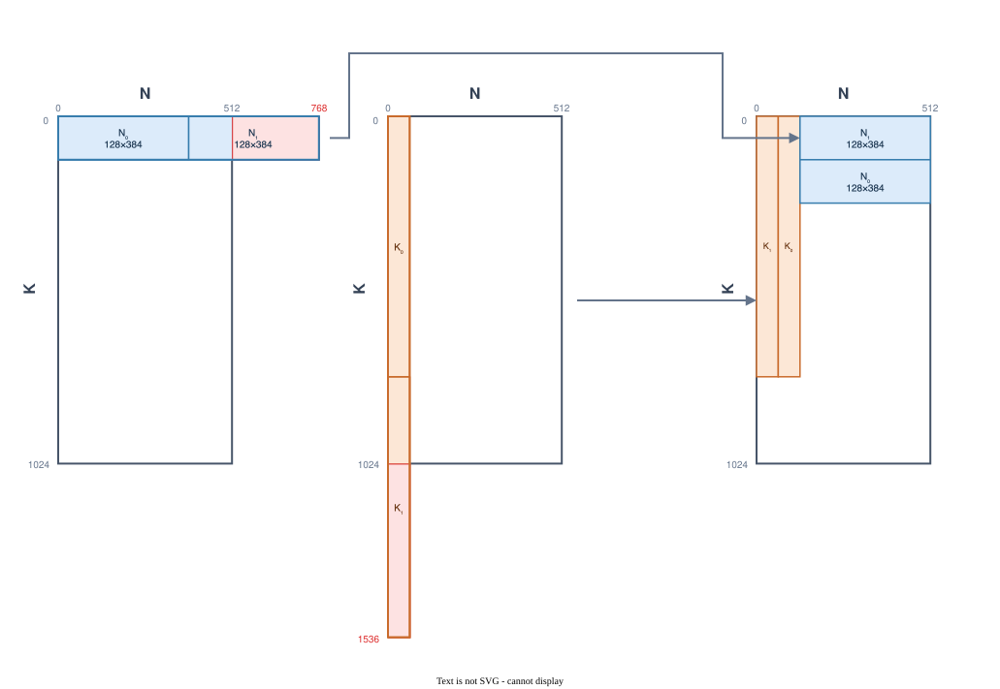

# 4.1　阵列分块合法化与逐元素算子融合

在目标翻译（Target Translation）流水线中，计算任务首先进入 `CIMLegalizeArrayTilesPass`。该阶段的核心目标是将高维或超出硬件容量约束的逻辑矩阵收缩，合法化为严格符合物理阵列几何约束（$K \le 1024, N \le 512$）的二维切片序列，并通过算子融合消除临时中间张量的片上内存开销。

---

## 4.1.1 硬件物理边界与数学模型

单个 CIM 阵列在 8 位整数下的物理计算边界为：
* **最大行容量**：$C_K = 1024$ 行（对应输入激活向量的最大长度）；
* **最大列容量**：$C_N = 512$ 列（对应单次计算的最大输出通道数）。

对于任意矩阵乘算子 $Y_{M \times N} = X_{M \times K} W_{K \times N}$，若 $K > 1024$ 或 $N > 512$，直接发射至硬件将导致越界执行。目标配置阶段已根据均匀均分原则决策出合法的分块步长 $K_T \le 1024$ 与 $N_T \le 512$。阵列合法化阶段据此执行二维代数展开：

\[
X W = \operatorname{concat}_N \left( \sum_{i=0}^{p_K-1} X_i W_{i,0}, \; \sum_{i=0}^{p_K-1} X_i W_{i,1}, \; \dots, \; \sum_{i=0}^{p_K-1} X_i W_{i, p_N-1} \right)
\]

其中 $X_i = X[:, i \cdot K_T : (i+1) \cdot K_T]$ 为输入分段，$W_{i,j} = W[i \cdot K_T : (i+1) \cdot K_T, \; j \cdot N_T : (j+1) \cdot N_T]$ 为权重子块。

---

## 4.1.2 解耦的双阶段 Lowering 流水线

传统分块常直接对所有维度一次性嵌套切分，容易造成后续逐元素算子无法融合、被迫生成大量临时存储缓冲区的问题。CIM 采用**解耦的双阶段分块与逐元素融合流水线**：

```text
[ 原始 Contraction + Downstream Elementwise Ops ]
                     │
                     ▼
  【 第一阶段：并行维切分与逐元素算子就地融合 】
  • 提取 Level 1 中的并行迭代器 (M 固定为 1, N = N_T)
  • tileConsumerAndFuseProducersUsingSCF 建立输出列循环
  • fuseElementwiseConsumers 将后续 Add/Sub/Mul 算子直接融合进并行循环
                     │
                     ▼
  【 第二阶段：归约维切分与部分和隔离 】
  • 提取收缩根算子中的归约迭代器 (K = K_T)
  • tileUsingSCF 仅对矩阵收缩生成内部 K-Loop
  • 生成部分和累加 (cim.elt add)，隔离在逐元素计算内部
                     │
                     ▼
[ 结构化 SCF 循环与局部视图，进入缓冲化 ]
```

### 第一阶段：并行维分块与就地消费者融合 (`tileAndFuseParallel`)
1. **输出列切分**：以 $N_T$ 为步长切分输出列，生成互不重叠的输出列切片视图；
2. **生产者向上融合**：自动将输入张量的切片提取（`tensor.extract_slice`）融合进输出循环；
3. **逐元素消费者向下融合 (`fuseElementwiseConsumers`)**：
   * 扫描循环的所有使用者，识别下游的纯逐元素算子（如偏置加法 `bias add`、激活函数 `relu` 等）；
   * 通过 `scf::tileAndFuseConsumer` 将逐元素计算直接移入该并行循环内部执行；
   * **核心收益**：各输出列计算完毕后立即就地完成偏置加法，**无需将未加偏置的完整矩阵乘结果物化到 SRAM 中**，大幅削减 SRAM 活跃期峰值。

### 第二阶段：归约维分块与部分和累加
对完成并行分块与算子融合后的矩阵收缩根算子，提取归约迭代器 $K_T$ 并独立调用 `scf::tileUsingSCF`：
* 生成嵌套在输出列循环内部的串行 $K$-Loop；
* 每次循环迭代消费一段 $1 \times K_T$ 输入与 $K_T \times N_T$ 权重，输出 $1 \times N_T$ 的 $i32$ 部分和；
* 首个部分和直接写入目标缓冲，后续部分和由显式加法（后续降低为 `cim.elt add`）累加；
* 归约完成后直接流向就地融合的逐元素算子，逻辑层次极其清晰。

---

## 4.1.3 二维切分演算实例



以合法化测试用例为例，模型中包含两个超限权重：
1. **超宽权重 $W_{\text{wide}} \in \mathbb{Z}^{128 \times 768}$（$N$ 超限）**：
   * 列容量为 512，最小均分因子为 2，分块尺寸为 $[128, 384]$；
   * 生成两个并列的 MVM 窗口，分别读取相同的 $[1, 128]$ 激活，直接写入输出的前 384 列与后 384 列区间；
2. **超高权重 $W_{\text{tall}} \in \mathbb{Z}^{1536 \times 64}$（$K$ 超限）**：
   * 行容量为 1024，最小均分因子为 2，分块尺寸为 $[768, 64]$；
   * 生成串行的两个 MVM 窗口，分别读取激活的前 768 维与后 768 维，第二个窗口产生的部分和通过 `cim.elt add` 累加至首个结果。

分块后的四个矩形总面积占物理阵列容量的 37.50%，且全部满足单阵列静态容纳要求。
