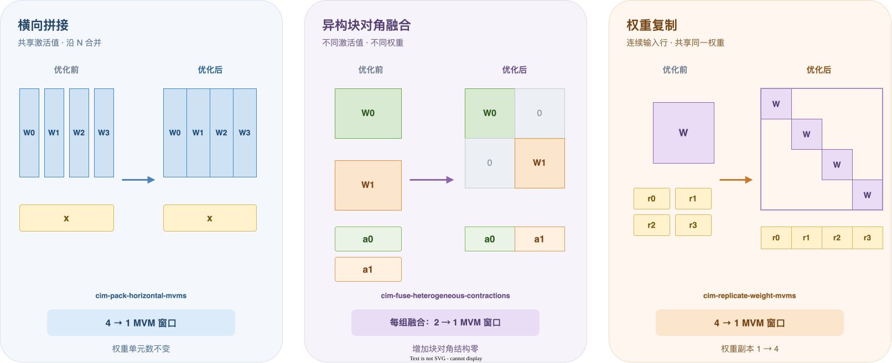
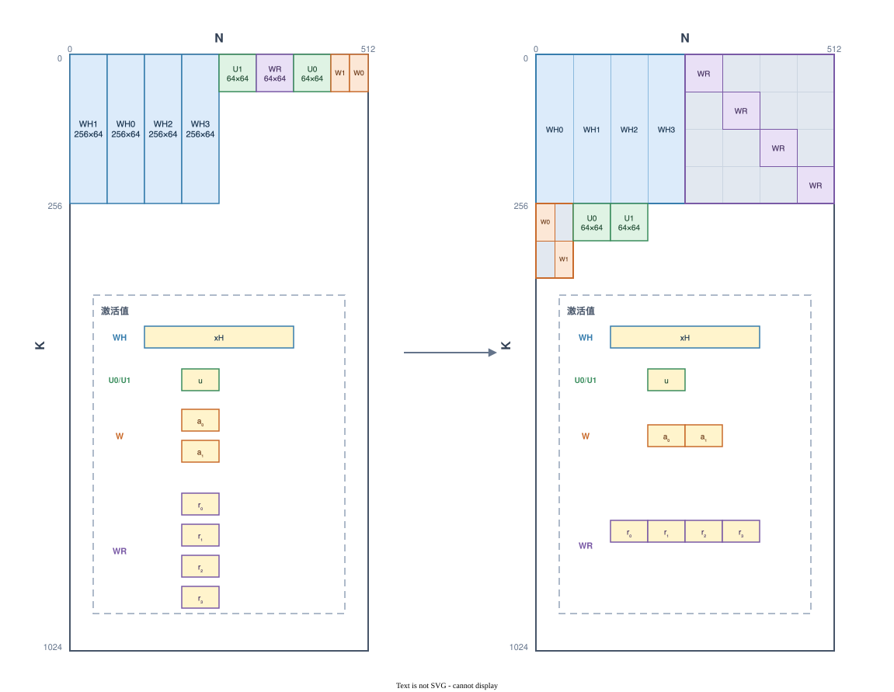

# 5.1　权重排布：用阵列空间减少计算窗口

一个逻辑 MVM 的阵列轮数等于激活值位宽：i8 执行 8 轮，i32 执行 32 轮。多个 MVM 合成一个窗口后，这些轮次随窗口数一起减少；拼接或块对角结构则决定新增的常驻阵列面积。

图 1 展示三种重组。黄色区域是送入新矩形的激活值，灰色区域是块对角结构中实际写入阵列的零。

## 共享激活值：横向拼接

同一 dispatch 内的多个 MVM 读取相同激活值 \(x\) 时，权重可以沿 N 方向拼接：

\[
x[W_0\ W_1\ \cdots\ W_r]
=[xW_0\ xW_1\ \cdots\ xW_r].
\]

新 MVM 产生一个宽结果。原结果若在内存中连续，可以直接把这些视图合成宽目标；否则先写入新的宽缓冲区，再为各消费者建立相应切片。权重总单元数不变，MVM 窗口从多个降为一个。

第 2 章形成的共同 dispatch 使链接后的程序仍能看到这些 MVM 的共享输入。物理拼接在此时发生，因为后端已经知道它们要与哪些其他权重共同驻留。

## 不同激活值：块对角融合

第 1 章在张量图上构造块对角计算：

\[
[x_0\ x_1]\operatorname{diag}(W_0,W_1)
=[x_0W_0\ x_1W_1].
\]

这项变换在链接前已经成为普通的静态权重和逻辑 MVM。链接阶段把该矩形与其他优化结果一起放置。对角线外的零参与部署面积计算，因此窗口收益伴随明确的阵列空间增长。

## 相同权重：块对角复制

连续的 L 行激活值使用同一权重 \(W_{K\times N}\) 时，可将 r 行拼接并复制权重：

\[
[x_0\ \cdots\ x_{r-1}]
\operatorname{diag}(W,\ldots,W)
=[x_0W\ \cdots\ x_{r-1}W].
\]

复制倍数受连续行数和阵列两维容量共同限制：

\[
r=\min\left(L,\left\lfloor\frac{1024}{K}\right\rfloor,
                 \left\lfloor\frac{512}{N}\right\rfloor\right).
\]

输入视图由 r 个 `[1,K]` 行展平为 `[1,rK]`，结果视图由 r 个 `[1,N]` 行展平为 `[1,rN]`。块对角矩形占用 \(r^2KN\) 个阵列单元，其中 \(rKN\) 个单元保存原权重，其他位置写零；这份空间将 r 个窗口合成一个。

异构融合与权重复制共用 `DenseWeight::blockDiagonal` 构造静态字节：前者传入不同矩阵，
后者重复引用同一矩阵。零填充和对角块偏移只实现一次；候选判定、激活与结果视图的改写
继续由各自所在的 tensor 或 linked MVM 阶段负责。

## 连续应用

每个候选先在当前逻辑程序的副本上形成新权重集合，并交给全局规划器试排。成功的布局使该候选进入主程序，后续变换继续从更新后的权重集合出发。

图 2 展示三种重组在同一个部署中的最终结果。横向分支的四个 `[256,64]` 权重沿 N 拼成一个 `[256,256]` 矩形；复制分支的四个 `[64,64]` 权重排成另一个 `[256,256]` 块对角矩形。两个分支都由四个 MVM 窗口降为一个。

异构分支将两个 `[64,32]` 权重融合为 `[128,64]` 块对角矩形。产生两段激活值的 `U0`、`U1` 权重各自保持 `[64,64]`，所以该分支最终占用三个矩形。五个优化后矩形共同进入下一步全局放置。

候选先经过内存合法性证明：MLIR 的别名与读写效应分析阻止跨越输入写入、结果读写或未知副作用；连续行还必须通过 MemRef 原生的可折叠布局判断。容量检查只构造权重清单，不克隆或提前改写 IR。每组独立接受，复制因子从大到小尝试；未被替换的旧权重使用仍计入全局容量。
