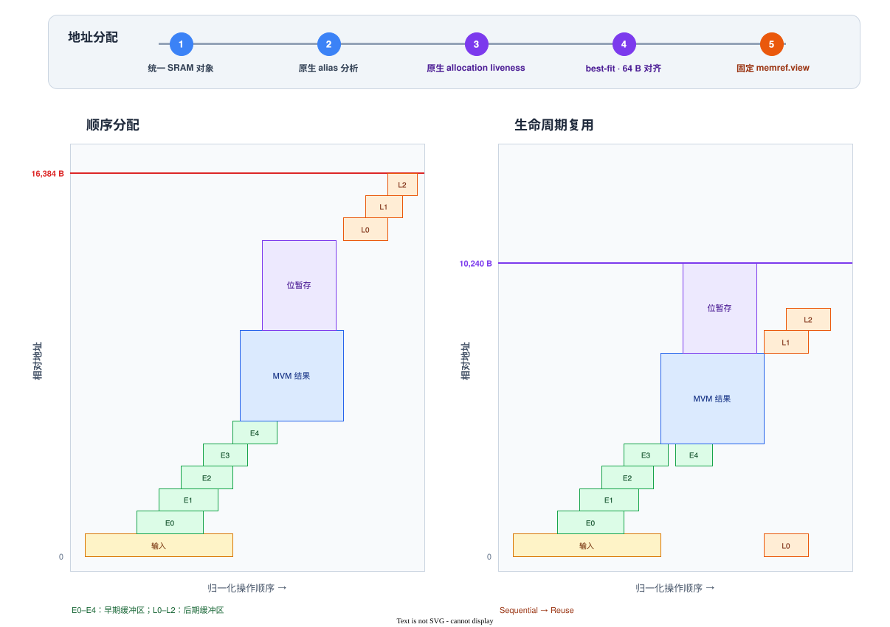

# 5.3　位串行计算与 SRAM

阵列坐标确定后，逻辑 MVM 已经具备物理权重视图。后端接着物化动态数据、展开实际计算轮次，并为完整的临时对象集合分配 SRAM 地址。

## 动态数据进入 SRAM

物理化为一次调用建立从 HAL binding 到 SRAM、再返回 binding 的数据流。输入和 executable 内嵌常量在首次读取前进入 SRAM，计算结果在最后一次写入后返回调用方；两者之间的矩阵乘结果和逐元素暂存都产生在这段 SRAM 中。

这些拷贝保留为原生 `memref.copy`，由序列化器直接生成物理 transfer。对象在切片、折叠或展开形状后仍可能产生多个视图，后续分配会把同一来源的视图视为一个物理对象。

## 展开二进制补码计算

阵列一次选取激活值的一个二进制位。对 B 位激活值

\[
x=-2^{B-1}x_{B-1}+\sum_{i=0}^{B-2}2^ix_i,
\]

一个逻辑 MVM 展开为：

```text
acc = bit(src, weight, 0)
for i = 1 .. B-2:
    tmp = bit(src, weight, i)
    tmp = tmp * 2^i
    acc = acc + tmp
tmp = bit(src, weight, B-1)
tmp = tmp * 2^(B-1)
acc = acc - tmp
```

每个 `cim.bit` 产生当前激活位与 i8 权重的 i32 点积。普通位乘以正位权后加入结果，最高符号位乘以 \(2^{B-1}\) 后扣除。i8 激活值产生 8 轮，i32 激活值产生 32 轮。

`tmp` 是真实的 `[1,N]` i32 SRAM 对象。展开完成后，程序中的动态对象已经包含边界数据、偏置、MVM 结果、K 分块部分和及位串行暂存。

## 边界导入的覆盖证明

边界缓冲区只有在每次读取的区域都已被完整写入时，才可以省略导入。物理化在原生
memref 类型传播之后，按操作顺序检查读取，再登记带 `FullEffect` 的写入；连续的静态
视图区间通过 LLVM `BitVector` 合并。整块导出也视为一次读取，因此局部写入不能丢失
边界上未被改写的数据。地址沿真实 view chain 归约，与权重读取和 payload 序列化共用
同一个实现；`memref.cast` 将类型 offset 放宽为动态值不会丢失原来的静态地址。

## 计算活跃区间

一个 SRAM 分配可能派生出多个别名视图。分配器先合并这些视图，再收集它们在物理操作序列中的全部使用位置。对象 \(b_i\) 表示为

\[
b_i=(s_i,a_i,[l_i,r_i)),
\]

其中 \(s_i\) 是字节数，\(a_i\) 是对齐要求，\([l_i,r_i)\) 是活跃区间。两个区间重叠的对象必须占用不同地址，已经结束的对象可以让出原区域。

## 最佳适配分配

`CIMAllocateSRAMPass` 为静态 entry allocation 设置对齐并补齐释放点，再运行 MLIR 原生
`OptimizeAllocationLivenessPass` 和 `StaticMemoryPlannerAnalysisPass`。后者根据
`reuse` 选项使用 `BestFit` 或 `Trivial`，并负责 arena 与视图改写；CIM 只检查最终 arena
是否超出硬件容量。顺序分配作为消融基线，两种策略共用这条原生路径。
面向用户的 `--sram-allocation=sequential|reuse` 选择保持不变。

对象按活跃起点处理。对当前对象，分配器从已有放置中找出仍然存活的地址段，并计算其间的空洞。每个候选起点先向上对齐到 64 B；能够容纳对象的候选中，选择放入后剩余空间最小的一段。现有空洞都不合适时，从当前占用末端继续扩展。



图 1 展示生命周期与地址复用：横轴表示程序顺序，纵轴表示相对地址。后期对象复用早期对象释放的地址，使峰值由同时存活的数据决定，而不是所有对象大小之和。

分配完成后，所有对象都成为同一个 i8 SRAM 根区域上的固定视图。根区域长度等于

\[
P=\max_i(o_i+s_i),
\]

其中 \(o_i\) 是对象偏移。`P` 必须不超过 524,288 B。后续序列化直接读取这些视图中的地址。
